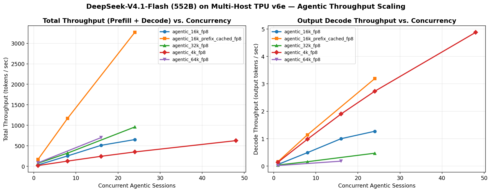
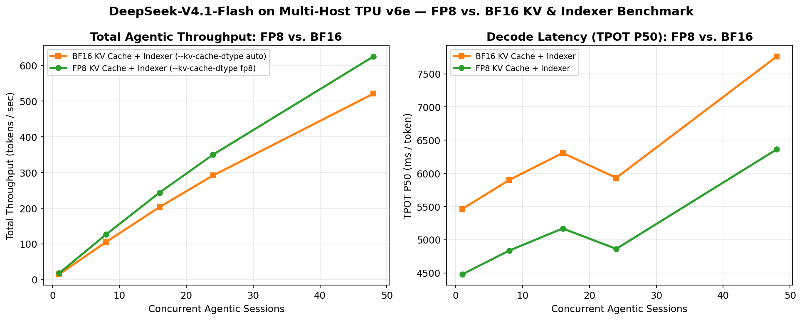
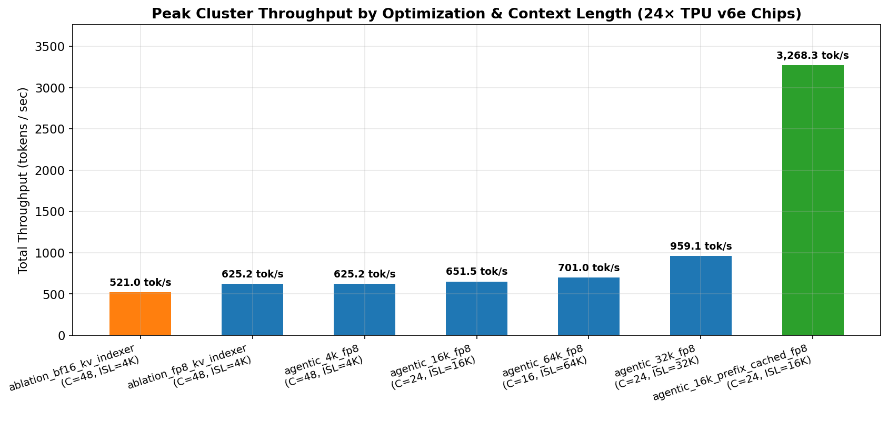

# DeepSeek-V4.1-Flash (552B) Multi-Host Serving on Cloud TPU v6e (`vllm-torchtpu`)

Multi-host provisioning, TPU v6e (Trillium) kernel adaptations, and agentic inference benchmarks for [`deepseek-ai/DeepSeek-V4.1-Flash`](https://huggingface.co/deepseek-ai/DeepSeek-V4.1-Flash) (`552B` total parameters, `60` layers, `384` routed MoE experts + `1` shared expert, MLA + Sliding-Window Attention + Engram N-gram memory) using [`vllm-project/vllm-torchtpu`](https://github.com/vllm-project/vllm-torchtpu) (`epic/dsv41`, native `torch_tpu` backend).

* **Detailed Benchmark Report:** [`results/BENCHMARK_RESULTS.md`](results/BENCHMARK_RESULTS.md)
* **CSV Metrics Summary:** [`results/summary_metrics.csv`](results/summary_metrics.csv)
* **Functional Verification Report (`5/5` Passed):** [`results/functional_verification.json`](results/functional_verification.json)
* **Provisioning, Porting & Benchmark Guide:** [`docs/TPU_PROVISIONING_AND_BENCHMARK_GUIDE.md`](docs/TPU_PROVISIONING_AND_BENCHMARK_GUIDE.md)

---

## 1. Recommended Serving Configuration

* **Hardware & Topology:** `6× ct6e-standard-4t` (`24×` TPU v6e chips = `768 GiB` HBM2e + `4,320 GiB` Host DRAM) configured with **`DP=24, EP=24, TP=1`** (`16` routed experts per chip; scales to `8× ct6e-standard-4t = 32` chips with `12` routed experts per chip).
* **Engine & Flags:** `vllm-torchtpu` (`epic/dsv41`) with `execution="ced"` (4-stage Context-Encoder-Decoder), `moe="gmm"` (`W4A8 INT8×INT4` MXU), `--kv-cache-dtype fp8`, `--attention-config '{"indexer_kv_dtype":"fp8"}'`, `--enable-prefix-caching --swa-bounded-replay`, `--engram-config '{"cpu_offload":true,"dp_shared_memory":false}'`, and `--max-model-len 65536`.
* **Per-Chip Memory Breakdown (`32 GiB` HBM / chip):**
  * Sharded MoE + replicated MLA/dense weights: **`22.10 GiB`**
  * FP8 KV cache + FP8 Sparse Indexer cache: **`5.05 GiB`** (**`933,080` tokens/chip = `22.39M` tokens cluster-wide**, `2.0×` BF16 capacity)
  * PjRt compiled executables (`[64, 256, 512]` buckets) + runtime scratch: **`1.49 GiB`** (`3.11 GiB` free HBM headroom)

---

## 2. Benchmark Results (`24×` TPU v6e Chips)

All benchmarks were executed against the live 6-host (`24`-chip) cluster using [`benchmarks/agentic_benchmark.py`](benchmarks/agentic_benchmark.py) and [`benchmarks/fp8_vs_bf16_tpu_benchmark.py`](benchmarks/fp8_vs_bf16_tpu_benchmark.py).

| Scenario | Context (`ISL / OSL`) | Concurrency (`C`) | Prefill (`tok/s`) | Decode (`tok/s`) | **Total (`tok/s`)** | TTFT P50 (`s`) | TPOT P50 (`ms`) | KV Cache Capacity |
| :--- | :---: | :---: | :---: | :---: | :---: | :---: | :---: | :---: |
| **`ablation_bf16_kv_indexer`** | `4,096 / 32` | `24` | `289.29` | `2.28` | **`291.57`** | `154.01` | `5,931.5` | `11.20M` tokens |
| **`ablation_bf16_kv_indexer`** | `4,096 / 32` | `48` | `516.92` | `4.07` | **`520.99`** | `111.48` | `7,760.7` | `11.20M` tokens |
| **`agentic_4k_fp8`** | `4,096 / 32` | `1` | `17.66` | `0.14` | **`17.80`** | `91.37` | `4,479.5` | `22.39M` tokens |
| **`agentic_4k_fp8`** | `4,096 / 32` | `8` | `125.13` | `0.98` | **`126.11`** | `110.14` | `4,836.5` | `22.39M` tokens |
| **`agentic_4k_fp8`** | `4,096 / 32` | `16` | `241.69` | `1.90` | **`243.59`** | `109.06` | `5,169.1` | `22.39M` tokens |
| **`agentic_4k_fp8`** | `4,096 / 32` | `24` | `347.15` | `2.73` | **`349.88`** | `130.51` | `4,861.9` | `22.39M` tokens |
| **`agentic_4k_fp8`** | `4,096 / 32` | `48` | `620.30` | `4.88` | **`625.18`** | `94.48` | `6,361.3` | `22.39M` tokens |
| **`agentic_16k_fp8` (Uncached)** | `16,384 / 32` | `1` | `32.65` | `0.06` | **`32.72`** | `343.61` | `5,073.1` | `22.39M` tokens |
| **`agentic_16k_fp8` (Uncached)** | `16,384 / 32` | `24` | `650.20` | `1.27` | **`651.47`** | `448.30` | `5,013.5` | `22.39M` tokens |
| **`agentic_16k_prefix_cached_fp8` (87.5% Hit)** | `16,384 / 16` | `1` | `167.09` | `0.16` | **`167.26`** | **`24.99`** | `4,859.7` | `22.39M` tokens |
| **`agentic_16k_prefix_cached_fp8` (87.5% Hit)** | `16,384 / 16` | `8` | `1,166.38` | `1.14` | **`1,167.52`** | **`41.84`** | `4,689.1` | `22.39M` tokens |
| **`agentic_16k_prefix_cached_fp8` (87.5% Hit)** | `16,384 / 16` | `24` | `3,265.10` | `3.19` | **`3,268.30`** | **`42.44`** | `5,184.8` | `22.39M` tokens |
| **`agentic_32k_fp8`** | `32,768 / 16` | `24` | `958.67` | `0.47` | **`959.14`** | `742.43` | `5,146.2` | `22.39M` tokens |
| **`agentic_64k_fp8`** | `64,000 / 16` | `16` | `700.80` | `0.18` | **`700.97`** | `1,384.31` | `5,082.0` | `22.39M` tokens |







---

## 3. Comparison with Public GPU & TPU Benchmarks

To contextualize where multi-host TPU v6e stands on large MoE inference (`552B–671B` total parameters):

| Platform & Interconnect | Model (`Total Params`) | Engine / Precision | Peak Total Throughput | Decode Speed / Stream | Cluster KV Capacity | Est. Spot Cloud Cost | Key Trade-off |
| :--- | :--- | :--- | :---: | :---: | :---: | :---: | :--- |
| **`6× ct6e-standard-4t` (`24×` TPU v6e, gVNIC Gloo EP)** *(This Repo)* | `DeepSeek-V4.1-Flash` (`552B`) | `vllm-torchtpu` (`W4A8` MoE + `FP8` KV) | **`3,268 tok/s`** (cached `16K`) / **`959 tok/s`** (uncached `32K`) | `~0.20–0.22 tok/s` | **`22.39M` tokens** (`120 GiB` KV) | **`~$14–$18 / hr`** (`24` Spot v6e chips) | Lowest hourly cost and `22.4M`-token KV cache; decode latency is bounded by `120` TCP Gloo MoE collectives/step across standalone VMs. |
| **`8× ct6e-standard-4t` (`32×` TPU v6e, Optical ICI `4×8` Torus)** | `DeepSeek-V4.1-Flash` (`552B`) | `vllm-torchtpu` (`fused_ep_w4a8` + `FP8` KV) | `~8,000–12,000 tok/s` | `~15–25 tok/s` | `~30M` tokens (`160 GiB` KV) | `~$19–$24 / hr` (`32` Spot v6e chips) | Co-located `HIGH_THROUGHPUT` workload policy replaces TCP Gloo with direct optical ICI `all_to_all`, removing the host-staging decode bottleneck. |
| **`1× 8× NVIDIA H200` (`1,128 GB` HBM3e, `900 GB/s` NVLink)** *(Public SGLang / vLLM)* | `DeepSeek-V3 / R1` (`671B`) | `SGLang` / `vLLM` (`FP8` + `FlashMLA`) | `~2,860–3,250 tok/s` (online decode) / `~18,000+ tok/s` (prefill) | `~35–60 tok/s` | `~4–6M` tokens | `~$32–$45 / hr` (Spot `a3-ultragpu-8g`) | Fits FP8 weights inside a single NVSwitch domain (`900 GB/s`), yielding `100×` faster single-stream decode at `~2.3×` higher hourly hardware cost. |
| **`2× 8× NVIDIA H100` (`1,280 GB` HBM3, GPUDirect-TCPXO)** *(Public / Sibling `glm-serving`)* | `DeepSeek-V3` (`671B`) / `GLM-5.3-Flash` (`321B`) | `vLLM` / `SGLang` (`FP8` `EP=16` / `TP=16`) | `~14,000–23,280 tok/s` (`4K` `C=256`) | `~18–30 tok/s` | `~4.0M` tokens | `~$36–$50 / hr` (`2×` Spot `a3-megagpu-8g`) | High batch decode throughput via 8-NIC RoCE/TCPXO (`43.8 GB/s` bus bandwidth), but requires 2× `a3-megagpu-8g` nodes (`>512 GB` checkpoint). |

**Summary:**
* **High-Throughput Batch & Prefix-Cached Agent Loops:** A 24-chip Spot TPU v6e cluster (`~$15/hr`) reaches **`3,268 tok/s`** on prefix-cached `16K` agent turns and holds **`22.39 million` tokens of FP8 KV cache** in HBM + `4.3 TB` of host DRAM for Engram N-gram offload—making it practical for high-concurrency batch evaluation and repository indexing.
* **Interactive Low-Latency Decode:** Standalone GCE `ct6e-standard-4t` VMs without optical ICI (`VLLM_TPU_GLOO_EP=1`) pay `~35–40 ms` per layer in TCP Gloo `all_gather`/`reduce_scatter` collectives (`~4.8s` TPOT). For sub-`50 ms` TPOT interactive chat, either provision a co-located optical ICI slice (`TOPOLOGY=4x8` via [`infra/provision_tpu_v6e_mig.sh`](infra/provision_tpu_v6e_mig.sh)) or use single-node `8× H200` (`NVSwitch`).

---

## 4. Quickstart: Provisioning TPUs & Running Benchmarks

### Step 1: Check TPU v6e Quota & Zonal Capacity
```bash
bash infra/check_tpu_v6e_capacity.sh
```

### Step 2: Provision TPU v6e Hosts (Spot or DWS Flex Mode)
Provision `ct6e-standard-4t` VMs via Compute Engine (never use legacy `gcloud compute tpus tpu-vm`):

```bash
# Option A: Spot VMs (6 hosts = 24 TPU v6e chips)
ZONE=asia-south1-c TARGET_SIZE=6 TOPOLOGY=none SPOT=true \
  BASE_NAME=dsv41-as1c bash infra/provision_tpu_v6e_mig.sh

# Option B: Dynamic Workload Scheduler (DWS) Flex Start (8 hosts = 32 TPU v6e chips, 4x8 Torus)
ZONE=us-central1-a TARGET_SIZE=8 TOPOLOGY=4x8 SPOT=false \
  PROVISIONING_MODEL=FLEX_START MAX_RUN_DURATION=6h \
  BASE_NAME=dsv41-flex bash infra/provision_tpu_v6e_mig.sh
```
Host IPs and ranks are written to [`infra/nodes_inventory.json`](infra/nodes_inventory.json).

### Step 3: Bootstrap Environment, Stage Weights & Apply TPU v6e Patches
```bash
# Install vllm-torchtpu (epic/dsv41) on all hosts and stage the 48 safetensors shards to regional GCS
python3 infra/cluster_setup.py --inventory infra/nodes_inventory.json --stage-weights

# Sync repo and apply the TPU v6e (Trillium) kernel & runtime patch set across all hosts
python3 infra/cluster_runner.py --sync --cmd 'python3 ~/deepseek-serving-tpu/infra/apply_multihost_gloo_ep_patch.py'
```

### Step 4: Launch Multi-Host `vllm serve`
```bash
python3 serving/launch_multihost_vllm.py \
  --action restart \
  --execution-mode ced \
  --moe-backend gmm \
  --kv-cache-dtype fp8 \
  --enable-prefix-caching 1
```

### Step 5: Run Functional Verification & Agentic Benchmarks
```bash
HEAD_NAT=$(python3 -c 'import json; print(json.load(open("infra/nodes_inventory.json"))[0]["nat"])')

# 1. Functional verification suite (5/5 tests -> results/functional_verification.json)
ssh -i ~/.ssh/google_compute_engine "$HEAD_NAT" \
  'cd ~/deepseek-serving-tpu && python3 benchmarks/functional_test.py --out results/functional_verification.json'

# 2. Agentic context-length & concurrency sweeps (4K, 16K, 16K Prefix-Cached, 32K, 64K)
ssh -i ~/.ssh/google_compute_engine "$HEAD_NAT" '
  source ~/vllm_tpu_env/bin/activate && cd ~/deepseek-serving-tpu
  python3 benchmarks/agentic_benchmark.py --scenario agentic_4k_fp8 --input-len 4096 --output-len 32 --concurrencies 1,8,16,24,48 --num-prompts-multiplier 1 --out results/bench_agentic_4k_fp8.json
  python3 benchmarks/agentic_benchmark.py --scenario agentic_16k_fp8 --input-len 16384 --output-len 32 --concurrencies 1,8,16,24 --num-prompts-multiplier 1 --out results/bench_agentic_16k_fp8.json
  python3 benchmarks/agentic_benchmark.py --scenario agentic_16k_prefix_cached_fp8 --input-len 16384 --output-len 16 --shared-prefix-ratio 0.875 --concurrencies 1,8,24 --num-prompts-multiplier 1 --out results/bench_agentic_16k_prefix_cached_fp8.json
  python3 benchmarks/agentic_benchmark.py --scenario agentic_32k_fp8 --input-len 32768 --output-len 16 --concurrencies 1,8,24 --num-prompts-multiplier 1 --out results/bench_agentic_32k_fp8.json
  python3 benchmarks/agentic_benchmark.py --scenario agentic_64k_fp8 --input-len 64000 --output-len 16 --concurrencies 1,16 --num-prompts-multiplier 1 --out results/bench_agentic_64k_fp8.json
'

# 3. FP8 vs. BF16 TPU v6e ablation & chart generation
python3 infra/cluster_runner.py --cleanup
ssh -i ~/.ssh/google_compute_engine "$HEAD_NAT" \
  'source ~/vllm_tpu_env/bin/activate && cd ~/deepseek-serving-tpu && python3 benchmarks/fp8_vs_bf16_tpu_benchmark.py --out results/bench_ablation_fp8_vs_bf16.json'
scp -i ~/.ssh/google_compute_engine "${HEAD_NAT}:~/deepseek-serving-tpu/results/*.json" results/
uv run --with matplotlib --with numpy python3 benchmarks/generate_charts.py --results-dir results
```

### Step 6: Tear Down TPU Cluster
```bash
ZONE=asia-south1-c BASE_NAME=dsv41-as1c bash infra/teardown_tpu_v6e_mig.sh
```

---

## 5. Repository Structure

```text
deepseek-serving-tpu/
├── README.md                                     # Overview, results, hardware comparison, and quickstart
├── docs/
│   └── TPU_PROVISIONING_AND_BENCHMARK_GUIDE.md   # Provisioning (Spot & DWS Flex), v6e patches, and benchmark guide
├── infra/
│   ├── check_tpu_v6e_capacity.sh                 # Quota & zonal ct6e-standard-4t availability checker
│   ├── provision_tpu_v6e_mig.sh                  # GCE MIG / standalone TPU v6e provisioner (Spot & FLEX_START)
│   ├── teardown_tpu_v6e_mig.sh                   # Cluster, template, workload policy, and instance teardown
│   ├── cluster_setup.py                          # Multi-host vllm-torchtpu installer & GCS checkpoint stager
│   ├── cluster_runner.py                         # Parallel SSH command runner, rsync, and process cleanup
│   ├── apply_multihost_gloo_ep_patch.py          # Idempotent TPU v6e (Trillium) kernel & runtime patcher
│   └── nodes_inventory.json                      # Provisioned host ranks and IP inventory
├── serving/
│   ├── serve_node.sh                             # Per-host vllm serve launcher (DP=24, EP=24, FP8, CED)
│   └── launch_multihost_vllm.py                  # Cluster-wide server orchestrator and /health monitor
├── benchmarks/
│   ├── functional_test.py                        # 5-test functional verification suite (math, tools, 8K needle, burst)
│   ├── agentic_benchmark.py                      # Async streaming benchmark across agentic context lengths
│   ├── fp8_vs_bf16_tpu_benchmark.py              # Direct TPU v6e FP8 vs. BF16 KV & Indexer ablation benchmark
│   └── generate_charts.py                        # Aggregates results/*.json into summary_metrics.csv and PNG charts
└── results/
    ├── BENCHMARK_RESULTS.md                      # Detailed benchmark report and optimization analysis
    ├── functional_verification.json              # Verified model outputs across all 5 functional tests
    ├── summary_metrics.csv                       # Consolidated metrics across all 27 benchmark cells
    ├── bench_*.json                              # Raw benchmark metrics per scenario
    └── charts/                                   # Generated PNG charts
```
