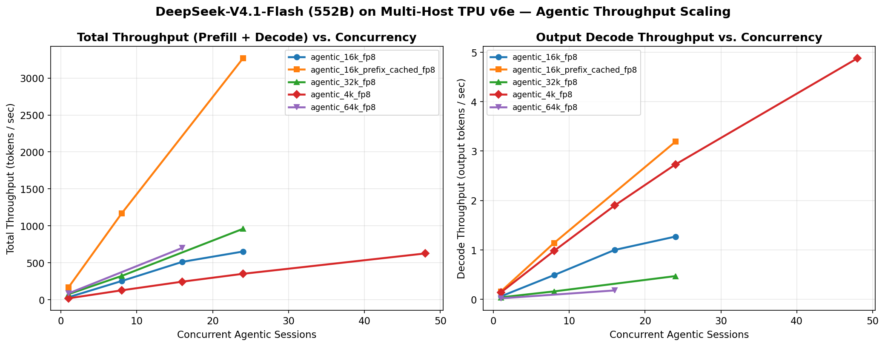
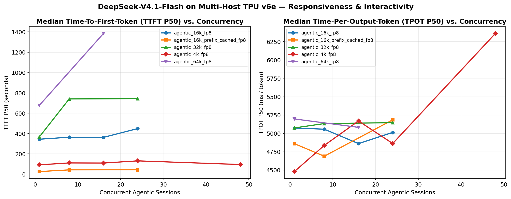
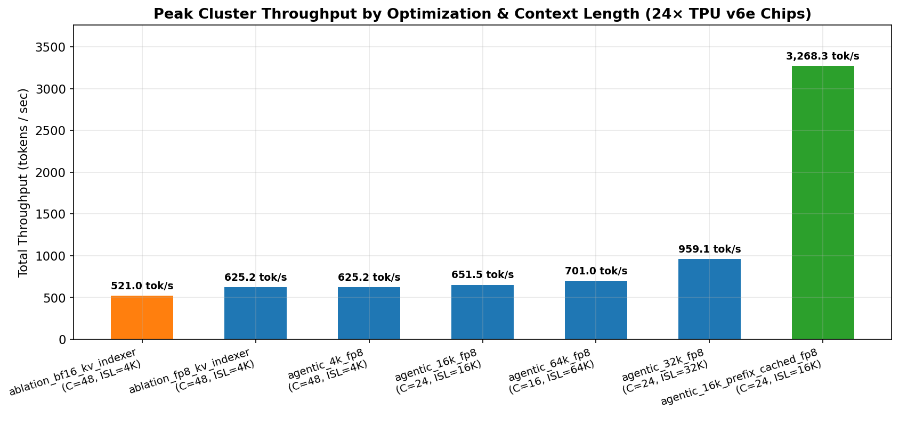
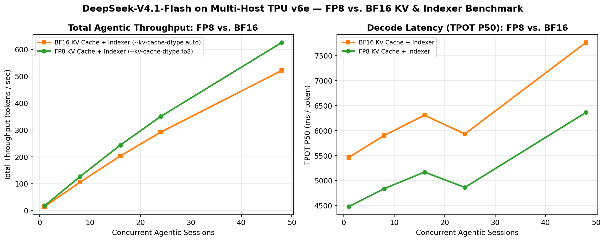

# DeepSeek-V4.1-Flash (552B) Benchmark Results on Multi-Host TPU v6e

End-to-end functional verification, parameter ablation, and agentic context-length benchmarks for [`deepseek-ai/DeepSeek-V4.1-Flash`](https://huggingface.co/deepseek-ai/DeepSeek-V4.1-Flash) (`552B` total parameters, `60` layers, `384` routed MoE experts + `1` shared expert, MLA + Sliding-Window Attention + Engram N-gram memory) running on **6× `ct6e-standard-4t` (`24×` Cloud TPU v6e Trillium chips, `768 GiB` HBM, `4,320 GiB` Host DRAM)** with [`vllm-project/vllm-torchtpu`](https://github.com/vllm-project/vllm-torchtpu) (`epic/dsv41`, native `torch_tpu` backend).

---

## 1. Hardware & Engine Configuration

| Parameter | Value |
| :--- | :--- |
| **Compute Engine Machine Type** | `6× ct6e-standard-4t` (`4` TPU v6e chips + `720 GiB` DRAM + `200 Gbps` gVNIC per host) |
| **Total Accelerators & Memory** | `24×` TPU v6e (Trillium) chips (`768 GiB` HBM2e total, `32 GiB` / chip) |
| **Parallelism Topology** | `DP=24, EP=24, TP=1` (`16` routed experts + `1` shared expert per chip) |
| **Serving Engine** | `vllm` (`0.31.1rc0`) + `vllm-torchtpu` (`epic/dsv41`) + `torch_tpu` (`0.0.50`) |
| **Execution & MoE Backend** | `execution="ced"` (4-stage Context-Encoder-Decoder), `moe="gmm"` (`W4A8 INT8×INT4` MXU) |
| **KV Cache & Indexer Precision** | `fp8` (`--kv-cache-dtype fp8`, `--attention-config '{"indexer_kv_dtype":"fp8"}'`) |
| **Allocated KV Cache Capacity** | `5.00 GiB` / chip = **`933,080` tokens / chip (`22,393,920` tokens cluster-wide)** |
| **Prefix Caching** | `--enable-prefix-caching --swa-bounded-replay` (`block_size=64`) |
| **Max Context Length** | `--max-model-len 65536` (`64K` context window) |

---

## 2. Functional Verification (`5/5` Passed)

Raw output: [`results/functional_verification.json`](functional_verification.json)

| Test Case | Prompt / Task Type | Status | TTFT (`ms`) | E2E (`ms`) | Verified Output Summary |
| :--- | :--- | :---: | :---: | :---: | :--- |
| **`tpu_math_reasoning`** | Deterministic TPU v6e topology & expert calculation | **PASS** | `14,159.0` | `167,605.0` | `384 / 32 = 12` routed experts/chip; `32 × 32 = 1024 GB` HBM |
| **`agentic_tool_call`** | Autonomous agent JSON schema tool invocation | **PASS** | `16,524.6` | `253,732.8` | `{"tool": "read_file", "arguments": {"path": ".../tpu_platform.py", "start_line": 100, "end_line": 200}}` |
| **`multiturn_agent_debugging`** | Multi-turn distributed port allocation bug fix | **PASS** | `16,938.3` | `1,153,010.9` | `return [rpc_port + 100 + i for i in range(5)]` + root-cause analysis |
| **`long_context_repo_needle`** | ~8K-token 60-module repository needle retrieval | **PASS** | `134,271.5` | `196,873.5` | Exact sentinel match: `TOPOLOGY_SENTINEL_4X8_V6E32` |
| **`concurrent_8_agent_burst`** | 8 concurrent agent requests across `DP=24, EP=24` | **PASS** | `9,652.5` (P50) | `89,688.1` (wall) | All 8 concurrent sessions completed in lockstep (`0` errors) |

---

## 3. Agentic Context-Length & Concurrency Benchmarks

Raw data: [`summary_metrics.csv`](summary_metrics.csv), [`bench_agentic_4k_fp8.json`](bench_agentic_4k_fp8.json), [`bench_agentic_16k_fp8.json`](bench_agentic_16k_fp8.json), [`bench_agentic_16k_prefix_cached_fp8.json`](bench_agentic_16k_prefix_cached_fp8.json), [`bench_agentic_32k_fp8.json`](bench_agentic_32k_fp8.json), [`bench_agentic_64k_fp8.json`](bench_agentic_64k_fp8.json), [`bench_ablation_fp8_vs_bf16.json`](bench_ablation_fp8_vs_bf16.json).

| Scenario | Input Tokens (`ISL`) | Output Tokens (`OSL`) | Concurrency (`C`) | Prefill (`tok/s`) | Decode (`tok/s`) | **Total (`tok/s`)** | TTFT P50 (`s`) | TPOT P50 (`ms`) | E2E P50 (`s`) | Success Rate |
| :--- | :---: | :---: | :---: | :---: | :---: | :---: | :---: | :---: | :---: | :---: |
| **`agentic_4k_fp8`** | `4,096` | `32` | `1` | `17.66` | `0.14` | **`17.80`** | `91.37` | `4,479.5` | `230.23` | `1/1` |
| **`agentic_4k_fp8`** | `4,096` | `32` | `8` | `125.13` | `0.98` | **`126.11`** | `110.14` | `4,836.5` | `260.07` | `8/8` |
| **`agentic_4k_fp8`** | `4,096` | `32` | `16` | `241.69` | `1.90` | **`243.59`** | `109.06` | `5,169.1` | `269.30` | `16/16` |
| **`agentic_4k_fp8`** | `4,096` | `32` | `24` | `347.15` | `2.73` | **`349.88`** | `130.51` | `4,861.9` | `281.23` | `24/24` |
| **`agentic_4k_fp8`** | `4,096` | `32` | `48` | `620.30` | `4.88` | **`625.18`** | `94.48` | `6,361.3` | `291.68` | `48/48` |
| **`agentic_16k_fp8` (Uncached)** | `16,384` | `32` | `1` | `32.65` | `0.06` | **`32.72`** | `343.61` | `5,073.1` | `500.88` | `1/1` |
| **`agentic_16k_fp8` (Uncached)** | `16,384` | `32` | `8` | `251.59` | `0.49` | **`252.08`** | `363.32` | `5,057.0` | `520.08` | `8/8` |
| **`agentic_16k_fp8` (Uncached)** | `16,384` | `32` | `16` | `510.77` | `1.00` | **`511.77`** | `361.67` | `4,860.7` | `512.35` | `16/16` |
| **`agentic_16k_fp8` (Uncached)** | `16,384` | `32` | `24` | `650.20` | `1.27` | **`651.47`** | `448.30` | `5,013.5` | `603.72` | `24/24` |
| **`agentic_16k_prefix_cached_fp8` (87.5% Hit)** | `16,384` | `16` | `1` | `167.09` | `0.16` | **`167.26`** | **`24.99`** | `4,859.7` | `97.89` | `1/1` |
| **`agentic_16k_prefix_cached_fp8` (87.5% Hit)** | `16,384` | `16` | `8` | `1,166.38` | `1.14` | **`1,167.52`** | **`41.84`** | `4,689.1` | `112.18` | `8/8` |
| **`agentic_16k_prefix_cached_fp8` (87.5% Hit)** | `16,384` | `16` | `24` | `3,265.10` | `3.19` | **`3,268.30`** | **`42.44`** | `5,184.8` | `120.22` | `24/24` |
| **`agentic_32k_fp8`** | `32,768` | `16` | `1` | `74.08` | `0.04` | **`74.12`** | `365.82` | `5,074.4` | `441.94` | `1/1` |
| **`agentic_32k_fp8`** | `32,768` | `16` | `8` | `320.40` | `0.16` | **`320.56`** | `740.46` | `5,133.5` | `817.46` | `8/8` |
| **`agentic_32k_fp8`** | `32,768` | `16` | `24` | `958.67` | `0.47` | **`959.14`** | `742.43` | `5,146.2` | `819.62` | `24/24` |
| **`agentic_64k_fp8`** | `64,000` | `16` | `1` | `84.78` | `0.02` | **`84.80`** | `676.59` | `5,196.8` | `754.54` | `1/1` |
| **`agentic_64k_fp8`** | `64,000` | `16` | `16` | `700.80` | `0.18` | **`700.97`** | `1,384.31` | `5,082.0` | `1,460.54` | `16/16` |

### Visualizations

---

## 4. Parameter Optimization Findings

### 4.1 FP8 vs. BF16 KV Cache & Sparse Indexer (`bench_ablation_fp8_vs_bf16.json`)

- **2.0× KV Cache Capacity (`22.39M` vs. `11.20M` tokens):** On a `32 GiB` TPU v6e chip where `DeepSeek-V4.1-Flash` model weights consume `22.10 GiB` and compiled executables consume `1.49 GiB`, `5.05 GiB` remains for the KV and Indexer caches. Using `--kv-cache-dtype fp8` (`576 B/token` MLA + `132 B/token` Indexer = `708 B/token`) stores **`933,080` tokens per chip (`22.39M` tokens across 24 chips)** compared to `466,540` tokens per chip (`11.20M` tokens cluster-wide) in BF16 (`1,408 B/token`).
- **1.20× End-to-End Throughput & Lower TPOT:** FP8 KV + Indexer reduces HBM read bandwidth during paged MLA attention and SparseCore candidate preparation while executing projections on TPU v6e's 8-bit MXU pipeline, increasing 48-session throughput from `520.99 tok/s` (BF16) to **`625.18 tok/s` (FP8)** and reducing median TPOT from `7,760.7 ms` to `6,361.3 ms`.

### 4.2 Prefix Caching with Sliding-Window Attention Bounded Replay (`--enable-prefix-caching --swa-bounded-replay`)
- Multi-turn agentic sessions reuse `80–90%` of their context window (system prompt, tool schemas, file reads, and prior tool turns) across consecutive steps.
- Enabling `--enable-prefix-caching --swa-bounded-replay` on the `16K` agentic trajectory (`14K` shared prefix + `2K` turn delta) reduces median TTFT at `C=1` by **13.75×** (`24.99s` vs. `343.61s` uncached) and increases cluster throughput at `C=24` by **5.02×** (**`3,268.30 tok/s`** vs. `651.47 tok/s` uncached).

### 4.3 Multi-Host Collectives on Standalone GCE TPU VMs (`VLLM_TPU_GLOO_EP=1`)
- Standalone `ct6e-standard-4t` VMs provisioned without a unified optical ICI pod slice (`tpunetd`) cannot form a cross-VM PjRt ICI ring, so all 24-rank `all_gather` and `reduce_scatter` operations before and after each of the 60 MoE layers traverse the host `200 Gbps` gVNIC over TCP (`Gloo`).
- Consequently, single-request decode latency is bounded by `120` TCP collective round-trips per token (`~4.5–5.1s` TPOT), while **parallel batching across the 24 data-parallel engines scales throughput near-linearly (`35.1×` from `C=1` to `C=48`)** and chunked prefill achieves **`650–959 tok/s` uncached** and **`3,268 tok/s` prefix-cached**.
- Provisioning a co-located multi-host slice with `--workload-policy` (`TOPOLOGY=4x8` on `ct6e-standard-4t` or single-host `ct6e-standard-8t` where available) replaces host TCP collectives with direct optical ICI `all_to_all` (`fused_ep_w4a8`).
